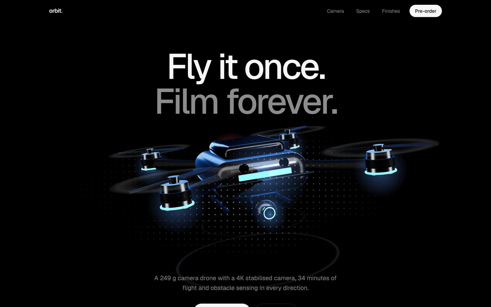
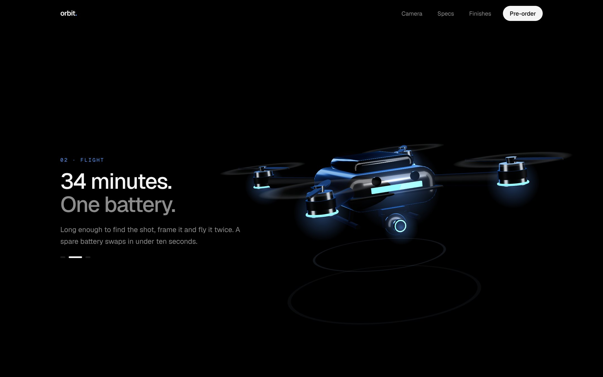
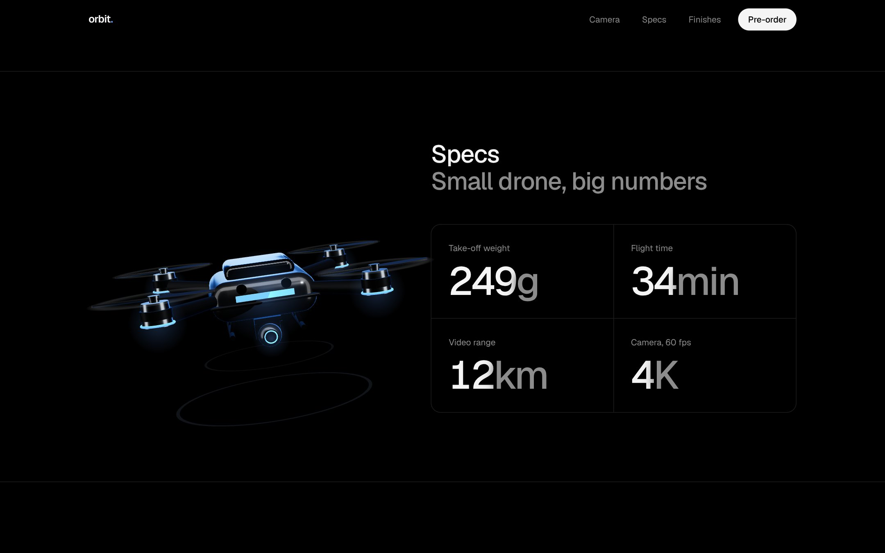
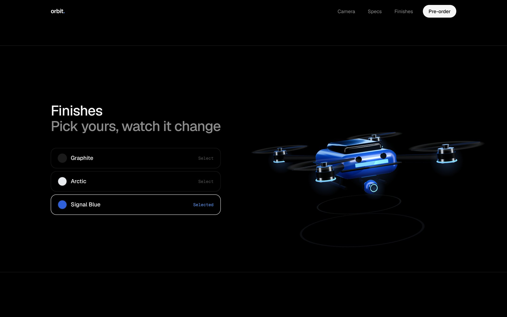
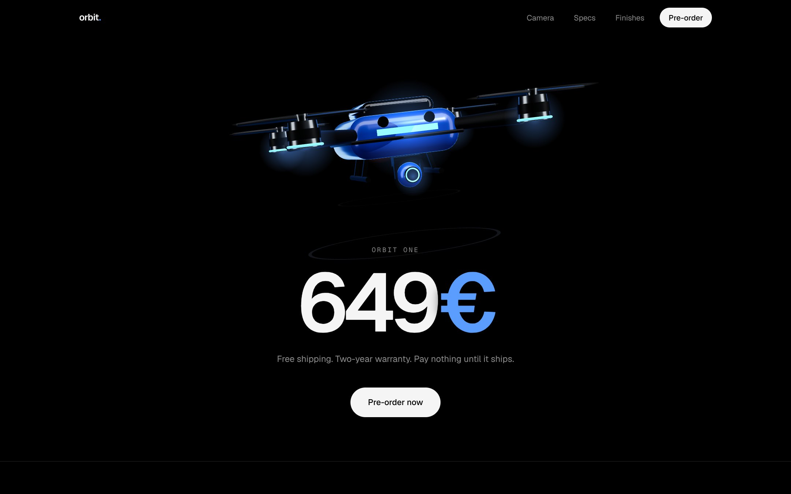
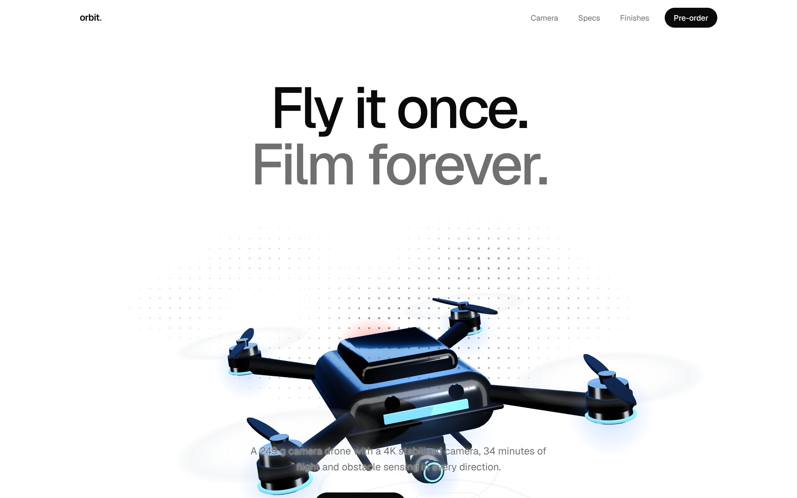
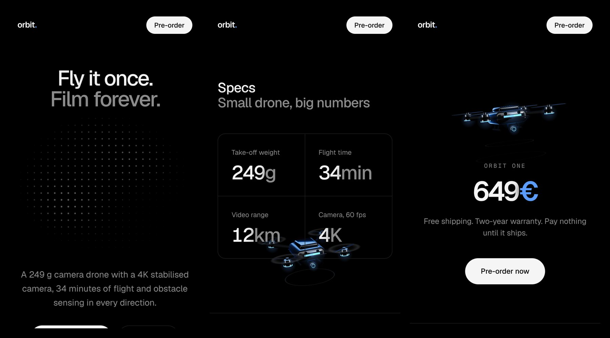

# Orbit — 3D drone launch template



A launch page for a camera drone, with a real-time 3D drone that glides down the page as you scroll. It stays level, does a full turn on itself between sections, then settles facing you in the empty space of each one. Resolution adapts on the fly to hold 60 fps.

Vite + React + TypeScript + Tailwind CSS + React Three Fiber.

## What's inside

| | |
| --- | --- |
|  |  |
| **Story.** Three short texts on the left, the drone holds the right. | **Specs.** Four big numbers, the drone sits beside them. |
|  |  |
| **Finishes.** Pick a colour and the drone repaints live. | **Pre-order.** One price, one button, the drone above it. |

Light and dark themes follow the visitor's system (or the toggle in the footer):



On phones the drone stays centred and smaller, in the gaps between blocks:



## Run

```bash
npm install
npm run dev
```

## Make it yours

- Texts, price, specs, finishes and FAQ: `src/config.ts`
- Where the drone sits in each section: the `choreography` table in `src/components/Scene.tsx` (`x`, `y` as fractions of the screen, `s` for size, `turn` for how many full turns it has made by then). Its heading is `HEADING` in the same file.
- The drone itself (built from shapes, no model file): `src/components/Drone.tsx`
- Want your own model instead? Load a `.glb` with `useGLTF` from `@react-three/drei`; shrink it first with `node scripts/optimize-model.mjs input.glb public/models/output.glb`

## Deploy

On [vercel.com](https://vercel.com): **Add New → Project**, pick this repository, keep the defaults (Vite) and deploy.

## Credits

The drone is modelled in code for this template. No third-party 3D assets.
